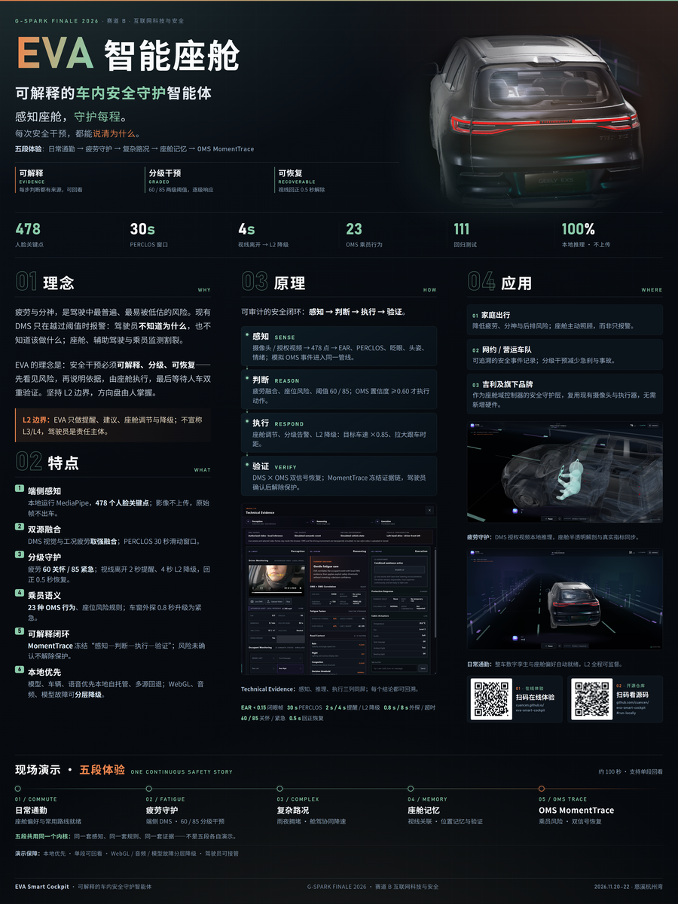

# EVA 智能座舱

**可解释的车内安全守护智能体** · G-SPark Finale 2026 · 赛道 B：互联网科技与安全

**[中文](README.md) · [English](README_EN.md)**

[](https://cuancen.github.io/eva-smart-cockpit/)
[](#安全边界重要)
[](#验证)
[](#功能一览)

EVA 把**端侧驾驶员监测（DMS）**、**语义化乘员监测（OMS）**、座舱记忆、座舱执行和受约束的 **L2 组合驾驶辅助**合并成一条可审计的安全闭环：**感知 → 判断 → 执行 → 验证**。默认演示是一段连续的五幕体验：**日常通勤 → 疲劳守护 → 复杂路况 → 座舱记忆 → OMS MomentTrace**。

| | |
|---|---|
| **在线体验** | [cuancen.github.io/eva-smart-cockpit](https://cuancen.github.io/eva-smart-cockpit/)（中国大陆访问可能不稳定，可按下文本地运行） |
| **展板** | 900 × 1200 mm 三折 KT 板，见下方 [展板](#展板--poster) |
| **技术栈** | Vite + React 18 + TypeScript + Three.js + MediaPipe Face Landmarker |

## 展板 / Poster

[](docs/kt-board/EVA_KT_Board_90x120_zh.pdf)

900 × 1200 mm 三折展板，主办方统一印刷；右栏两枚二维码分别指向**在线体验**与仓库的 **Run locally** 说明。

[中文印刷版 PDF](docs/kt-board/EVA_KT_Board_90x120_zh.pdf) · [中文高清 PNG](docs/kt-board/EVA_KT_Board_90x120_zh.png) · [English PDF](docs/kt-board/EVA_KT_Board_90x120_en.pdf) · [English PNG](docs/kt-board/EVA_KT_Board_90x120_en.png) · [English poster page](README_EN.md#poster)

## 安全边界（重要）

本项目演示的是 **L2 组合驾驶辅助**：车道级转向与加减速辅助，驾驶员需要持续监督。**驾驶员始终是责任主体**，必须随时准备接管。EVA 只做监测、提醒、建议、座舱调节和辅助降级，不宣称 L3/L4，也不做自动驾驶承诺。

- **DMS** 使用授权视频 / 本地视频，推理在浏览器本机完成，影像不上传。
- **OMS** 是**模拟语义事件**，界面已明确标注，不暗示真实后排传感器。
- 车速、疲劳速率、温度等为集中管理的**模拟参数**（`src/core/params.ts`），不是量产标定。

## 功能一览

| 模块 | 作用 |
|---|---|
| 视觉 DMS | 授权内置视频、用户主动选择的摄像头或本地视频 → MediaPipe Face Landmarker（478 点，端侧 WASM/GPU 推理，零上传）→ EAR / 眨眼率 / PERCLOS / 头部姿态 / 驾驶员在场 |
| 语义 OMS | 23 种模拟、座位感知的乘员状态，带置信度、持续时间和失效数据规则；主演示使用后排车窗风险，从不把 OMS 说成真实传感器 |
| 双源疲劳融合 | 工况疲劳（车速 / 路况 / 时长）与视觉 PERCLOS **取强融合**；≥60 关怀，≥85 紧急干预并给出休息选项 |
| 分心守护 | 视线离开 ≥2 秒提醒，≥4 秒紧急告警 + L2 降级（降低目标车速、拉大跟车时距）；注意力回正后自动恢复 |
| EVA 智能体 | 电影感旁白与自然语言控制：温度、音乐、按摩、导航、休息与 L2 辅助 |
| 复杂路况协同 | 雨夜 + 拥堵系数 ≥2 时限制娱乐、进入谨慎模式，路况缓解后自动恢复 |
| 数字孪生舞台 | 全屏 Three.js 整车舞台：石墨 / 深蓝环境分级、语义剖切材质、随车锚定的道路与城市、速度联动雨雾、带刹车灯的前车与分场景机位 |
| 可解释证据 | 默认人性化 Evidence 摘要，可展开三列“感知 / 推理 / 执行”工作台，完整键盘可达 |
| 五段体验 | 音频驱动的 21 拍连续演示，约 103 秒；每一段也可单独运行 |
| 双语首页 | 中文优先的中英双语编辑式首页，含可切换的座舱截图、五段入口和明确的 DMS/OMS/L2 边界 |

## 五段体验

1. **日常通勤**：座舱偏好与常用路线自动就绪。
2. **疲劳守护**：端侧 DMS，60 / 85 分级干预。
3. **复杂路况**：雨夜拥堵，舱驾协同降速。
4. **座舱记忆**：视线关联的位置记忆与验证。
5. **OMS MomentTrace**：乘员风险与双信号恢复。

五段共用同一套感知、同一套规则、同一套证据链，不是五段各自演示的动画。

<a id="run-locally"></a>

## 快速开始

需要 Node.js 20.19+（或 22.12+）与现代浏览器。

```bash
npm install     # postinstall 会把 MediaPipe WASM 复制到 public/（自托管，可离线）
npm run dev     # http://localhost:5173
npm test        # 111 项回归测试
npm run build   # 类型检查 + 生产构建
```

`/` 与 `#/landing` 打开首页；点击 **Run Full Demo** 可完整播放五段体验；直接访问 `#/cockpit` 会停在 **Start Experience**。未知 hash 一律回到首页，`#/board` 等已退役路由同样回到首页。

## 演示操作

- `Space`：开始 / 暂停 / 继续。
- `D`：重播当前体验或完整演示。
- `1` / `2` / `3`：日常通勤、疲劳守护、复杂路况。
- `L`：切换 L2 辅助。
- `Evidence`：查看 DMS/OMS 来源、推理依据、执行动作与驾驶员责任说明。

完整演示不会主动请求摄像头：疲劳守护段使用授权预录视频 `public/dms/d_360.mp4` 在本机推理；若本地推理失败，视频继续播放，不可用指标显示 `—` 而不是编造数值。**Live DMS** 与 **Upload Video** 是需要用户主动选择的证据输入，同样不上传。

英文模式使用 `public/audio/eva/en-US/` 的授权 MP3；中文模式使用浏览器 `zh-CN` 语音合成，不加载英文 MP3，也不生成中文克隆音色。切换语言不会打断当前节拍。

## 架构

```text
src/core/     DOM 无关的仿真、EVA 规则、参数与 L2 策略
src/vision/   MediaPipe DMS、纯函数指标与模拟回退信号
src/shell/    座舱 UI、可暂停时间线、Evidence 与数字孪生舞台
src/landing/  中文优先的中英双语首页与 3D 车辆 Hero
tests/        Core、vision、OMS、时间线、音频与交互回归测试
public/       自托管的人脸模型、车辆 GLB 与授权的 EVA 素材
docs/         Pipeline、决策记录、功能说明与 KT 展板
```

仿真时钟只在体验 `running` 时前进；Ready、暂停、Evidence 展开和完成状态都会冻结。高面数车辆只在需要运动时按上限渲染。WebGL 或 GLB 加载失败时，故事、证据、音频和控制仍可通过 EVA 状态回退继续。

## 可靠性与降级

- 视觉模型与 WASM 运行时自托管，本地优先、多源回退（本地 → jsDelivr → unpkg；GPU → CPU）。
- 摄像头拒绝、模型失败、WebGL 失败、音频不可用都不会阻塞演示。
- 重播会硬停止仍在播放的媒体，再从头开始。
- 返回首页会卸载座舱并停止演示、DMS 输入与旁白。

## 验证

```bash
npm test      # 5 个测试文件，111 项全部通过
npm run build # tsc --noEmit + vite build
```

## 竞赛资料

- [决策记录](docs/DECISIONS.md)
- [AI 使用声明](AI_USAGE.md)
- [第三方声明](THIRD_PARTY_NOTICES.md)
- [管线与参数表](docs/PIPELINE.md)
- [项目指南（英文）](PROJECT_GUIDE_EN.md)

## 相关仓库

- **上一届 HHCC 2026 仓库**：[cuancen/hhcc2026-proto-intelligent-vision](https://github.com/cuancen/hhcc2026-proto-intelligent-vision)
- **团队暂存镜像**：[b1207739631-rgb/hhcc-2026-prototype](https://github.com/b1207739631-rgb/hhcc-2026-prototype)

## 声明

- 演示中的速度、疲劳速率、温度等均为**模拟假设**，集中定义在 `src/core/params.ts`，不是量产标定。
- MediaPipe Face Landmarker 模型与运行时为 Apache-2.0，自托管。
- 车辆模型为社区作者 *crivero* 的 Sketchfab 作品（CC-BY，署名见 `AI_USAGE.md` 与页面页脚），**不是吉利官方素材**；材质在运行时渲染为石墨金属。
- 本仓库不包含凭据、个人数据、依赖目录、构建产物或研究工作区文件。
