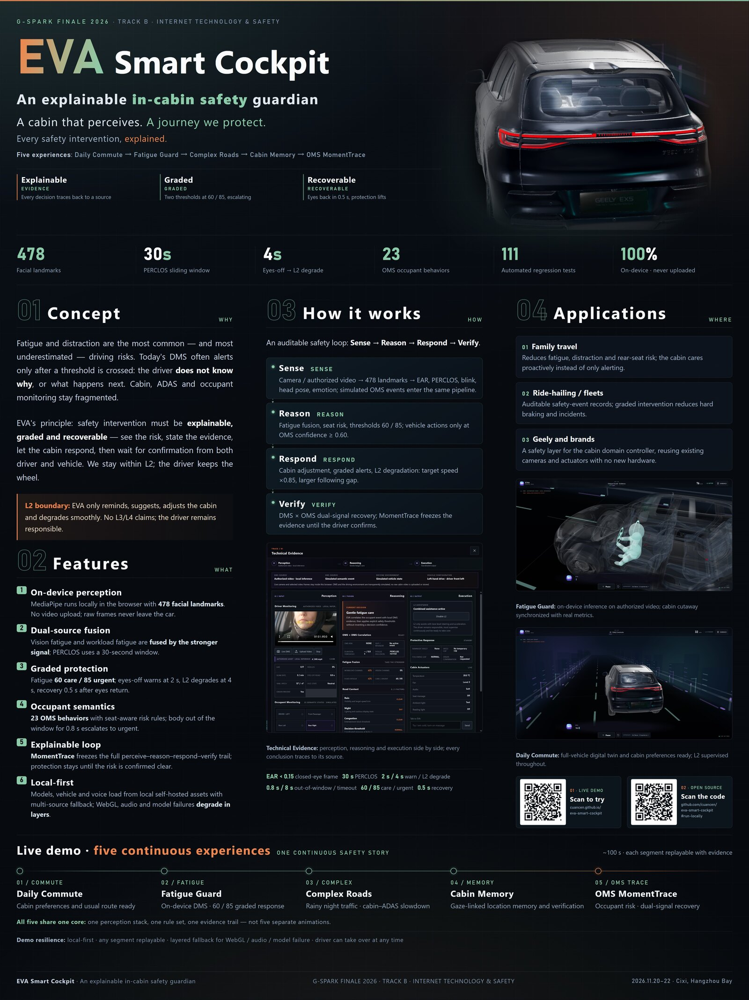

# EVA Smart Cockpit

**An explainable in-cabin safety guardian** · G-SPark Finale 2026 · Track B: Internet Technology & Safety

**[Chinese](README.md) · [English](README_EN.md)**

[](https://cuancen.github.io/eva-smart-cockpit/)
[](#safety-boundary)
[](#verification)
[](#whats-inside)

EVA combines **on-device driver monitoring (DMS)**, **semantic occupant monitoring (OMS)**, cabin memory, cabin actuation and guarded **L2 combined driving assistance** into one auditable safety loop: **Sense → Reason → Respond → Verify**. The default presentation is one continuous five-experience tour: **Daily Commute → Fatigue Guard → Complex Roads → Cabin Memory → OMS MomentTrace**.

| | |
|---|---|
| **Live demo** | [cuancen.github.io/eva-smart-cockpit](https://cuancen.github.io/eva-smart-cockpit/) (GitHub Pages can be slow or unreachable from mainland China; run locally below) |
| **Poster** | 900 × 1200 mm three-fold board — see [Poster](#poster) |
| **Stack** | Vite + React 18 + TypeScript + Three.js + MediaPipe Face Landmarker |

## Poster

[](docs/kt-board/EVA_KT_Board_90x120_en.pdf)

900 × 1200 mm three-fold board, printed by the organizer. The two QR codes in the right column open the **live demo** and the repository's **Run locally** section.

[English print PDF](docs/kt-board/EVA_KT_Board_90x120_en.pdf) · [English JPG](docs/kt-board/EVA_KT_Board_90x120_en.jpg) · [中文印刷版 PDF](docs/kt-board/EVA_KT_Board_90x120_zh.pdf) · [中文高清 JPG](docs/kt-board/EVA_KT_Board_90x120_zh.jpg) · [中文展板页](README.md#展板--poster)

## Safety boundary

This prototype demonstrates **L2 combined driving assistance**: lane-level steering and acceleration support with continuous driver supervision. **The driver remains the responsible party at all times** and must be ready to take over. EVA is limited to monitoring, alerts, recommendations, cabin adjustments and safe assistance degradation; it makes no L3/L4 or autonomous-driving claims.

- **DMS** uses authorized or user-selected video and runs inference locally in the browser; frames are never uploaded.
- **OMS** is a **simulated semantic event stream**, labelled as such in the UI; it never pretends to be a real rear-seat sensor.
- Speeds, fatigue rates and temperatures are **simulated assumptions** centralized in `src/core/params.ts`, not production calibration.

## What's inside

| Module | What it does |
|---|---|
| Machine-vision DMS | Authorized built-in video, user-selected camera or uploaded local video → MediaPipe Face Landmarker (478 points, on-device WASM/GPU inference, zero upload) → EAR / blink rate / PERCLOS / head pose / driver presence |
| Semantic OMS | 23 simulated, seat-aware occupant states with confidence, duration and stale-data rules; the main trace uses a rear-right window risk and never presents the OMS feed as real |
| Dual-source fatigue fusion | Driving-workload fatigue (speed / road / duration) fused with vision PERCLOS by **take-the-stronger**; ≥60 gentle care, ≥85 urgent intervention with a rest-choice branch |
| Distraction guard | Eyes-off-road ≥2 s warning, ≥4 s urgent alert + L2 degradation (lower target speed, longer headway); auto-recovery when attention returns |
| EVA agent | Cinematic one-line narration plus natural-language controls for temperature, music, massage, navigation, rest and L2 assistance |
| Complex-road synergy | Rain + night + congestion factor ≥2 blocks entertainment and enters cautious mode; auto-restore when conditions ease |
| Digital-twin stage | Full-screen Three.js vehicle stage with graphite/deep-blue grading, semantic cutaway materials, a vehicle-anchored road and city world, speed-linked rain/fog, a braking lead SUV and scene-specific cameras |
| Explainable evidence | Human-first Evidence summary by default; expandable three-column Perception / Reasoning / Execution workbench, fully keyboard accessible |
| Five-experience tour | Audio-led 21-beat tour of about 103 seconds; every experience also runs on its own |
| Bilingual landing | Chinese-first bilingual editorial page with switchable cockpit screenshots, five demo entries and explicit DMS/OMS/L2 boundaries |

## Five experiences

1. **Daily Commute** — cabin preferences and the usual route are ready.
2. **Fatigue Guard** — on-device DMS with 60 / 85 graded intervention.
3. **Complex Roads** — rainy-night congestion, cabin–ADAS cooperative slowdown.
4. **Cabin Memory** — gaze-linked location memory and verification.
5. **OMS MomentTrace** — occupant risk with dual-signal recovery.

All five share one perception stack, one rule set and one evidence trail — not five separate animations.

## Quick start

Requires Node.js 20.19+ (or 22.12+) and a modern browser.

```bash
npm install     # postinstall copies the MediaPipe WASM runtime into public/ (self-hosted, offline-ready)
npm run dev     # http://localhost:5173
npm test        # 111 regression tests
npm run build   # type-check + production build
```

`/` and `#/landing` open the introduction page; **Run Full Demo** plays all five experiences. A direct `#/cockpit` visit stays at **Start Experience**. Unknown hashes return to the landing page, and retired routes such as `#/board` do the same.

## Demo controls

- `Space`: start, pause or continue.
- `D`: replay the selected experience or the full demo.
- `1` / `2` / `3`: Daily Commute, Fatigue Guard or Complex Roads.
- `L`: toggle L2 assistance.
- `Evidence`: inspect DMS/OMS sources, reasoning, actions and driver responsibility.

The full demo never requests camera access: its Fatigue Guard segment uses the authorized prerecorded `public/dms/d_360.mp4` with local inference. If inference fails, the video keeps playing and unavailable metrics show `—` instead of fabricated values. **Live DMS** and **Upload Video** are explicitly selected evidence inputs and are never uploaded.

English mode uses the approved MP3 pack in `public/audio/eva/en-US/`; Chinese mode uses browser `zh-CN` speech synthesis, loads no English MP3s and generates no cloned Chinese voice. Changing language does not restart the current beat.

## Architecture

```text
src/core/     DOM-free simulation, EVA rules, parameters and L2 policy
src/vision/   MediaPipe DMS, pure metrics and simulated fallback
src/shell/    Cockpit UI, pausable timeline, Evidence and digital-twin stage
src/landing/  Chinese-first bilingual landing page with the 3D hero vehicle
tests/        Core, vision, OMS, timeline, audio and interaction regressions
public/       Self-hosted face model, vehicle GLB and approved EVA assets
docs/         Pipeline, decisions, feature guide and the KT board
```

The simulation clock advances only while the experience is `running`; ready, paused, Evidence-open and completed states freeze. The high-poly vehicle renders at a capped rate only while motion is required. If WebGL or the GLB fails, the story, evidence, audio and controls continue through the EVA status fallback.

## Resilience

- Vision model and WASM runtime are self-hosted with local-first, multi-source fallback (local → jsDelivr → unpkg; GPU → CPU).
- Camera refusal, model failure, WebGL failure and unavailable audio never block the demo.
- Replay hard-stops any active media before restarting.
- Returning to the landing page unmounts the cockpit and stops its demo, DMS inputs and narration.

## Verification

```bash
npm test      # 5 test files, 111 tests passing
npm run build # tsc --noEmit + vite build
```

## Competition records

- [Decision log](docs/DECISIONS.md)
- [AI usage disclosure](AI_USAGE.md)
- [Third-party notices](THIRD_PARTY_NOTICES.md)
- [Pipeline and parameters](docs/PIPELINE.md)
- [Project guide](PROJECT_GUIDE_EN.md)

## Related repositories

- **Previous HHCC 2026 repository**: [cuancen/hhcc2026-proto-intelligent-vision](https://github.com/cuancen/hhcc2026-proto-intelligent-vision)
- **Team staging mirror**: [b1207739631-rgb/hhcc-2026-prototype](https://github.com/b1207739631-rgb/hhcc-2026-prototype)

## Disclaimers

- Speeds, fatigue rates, temperatures and similar values in the demo are **simulated assumptions** defined in `src/core/params.ts`, not production calibration.
- The MediaPipe Face Landmarker model and runtime are Apache-2.0 and self-hosted.
- The vehicle model is a community-made Sketchfab model by *crivero* (CC-BY, attributed in `AI_USAGE.md` and the page footer), **not an official Geely asset**; its material is rendered as graphite metal at runtime.
- This repository contains no credentials, personal data, dependency directories, generated builds or research-workspace artifacts.
